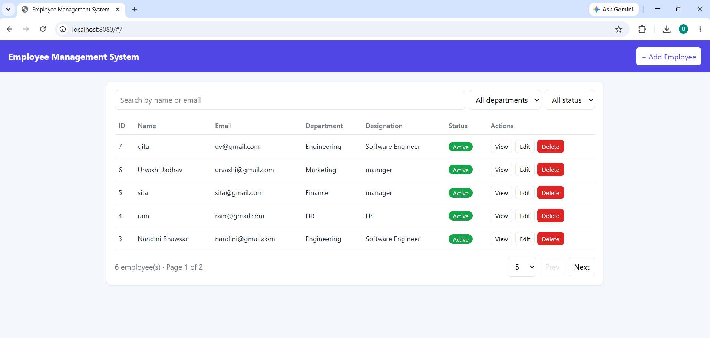
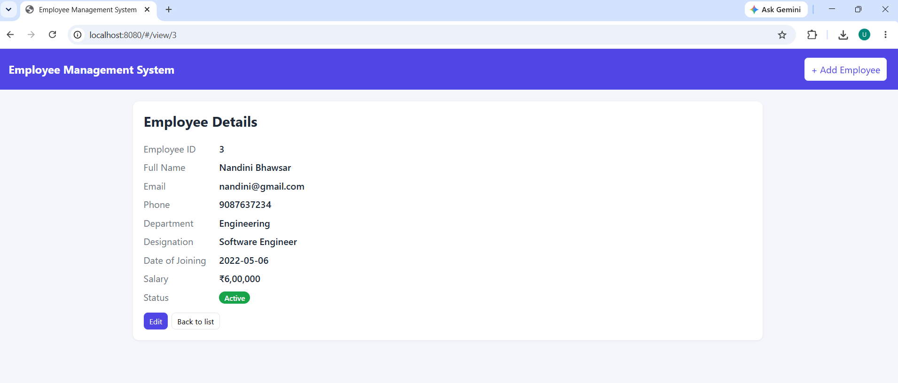

# Employee Management System

Spring Boot (Java 17) REST API + MySQL + a simple responsive frontend (HTML/JS, served by Spring Boot itself, so no separate build step and no CORS setup).

## Features
- Add, view, edit, delete (with confirmation), and list employees
- Search by name or email, filter by department and status, pagination
- Validation, duplicate email check, global exception handling
- Swagger/OpenAPI docs, JUnit 5 + Mockito service tests
- Docker Compose setup (bonus)

## Prerequisites
- Java 17+
- MySQL 8 running locally (user `root`, password `root`) **or** Docker
- Maven is not required (Maven wrapper included)

## Run locally
1. Start MySQL. The database `employee_db` and the table are created automatically.
   (Optional manual setup with sample data: run `db/schema.sql`.)
2. If your MySQL credentials differ, set `DB_USER` and `DB_PASSWORD` environment variables
   (or edit `src/main/resources/application.properties`).
3. Run:
   ```
   ./mvnw spring-boot:run        # Windows: mvnw.cmd spring-boot:run
   ```
4. Open:
   - App (frontend): http://localhost:8080/
   - Swagger UI: http://localhost:8080/swagger-ui/index.html

## Run with Docker
```
docker compose up --build
```
App: http://localhost:8080/ (MySQL is exposed on host port 3307).

## Run tests
```
./mvnw test
```
Service-layer tests use Mockito, so no database is needed.

## API
| Method | Endpoint | Description |
|---|---|---|
| POST | `/employees/create` | Create employee |
| GET | `/employees/get` | List (query: `search`, `department`, `status`, `page`, `size`) |
| GET | `/employees/get/{id}` | Get one employee |
| PUT | `/employees/update/{id}` | Update employee |
| DELETE | `/employees/delete/{id}` | Delete employee |

Sample body:
```json
{
  "fullName": "Urvashi Jadhav",
  "email": "urvashi@example.com",
  "phoneNo": "9876543210",
  "department": "Engineering",
  "designation": "Software Engineer",
  "dateOfJoining": "2026-10-01",
  "salary": 50000,
  "status": "Active"
}
```
`status` is `Active` or `Inactive`. Phone must be 10 digits starting with 6-9.
Postman collection: `postman/Employee_Management_System.postman_collection.json`.

## Project structure
```
src/main/java/.../controller | service | repository | entity | dto | exception
src/main/resources/static/index.html   # frontend
src/test/java/.../service              # unit tests
db/schema.sql  Dockerfile  docker-compose.yml  postman/
```

## Screenshots
### Employee List

